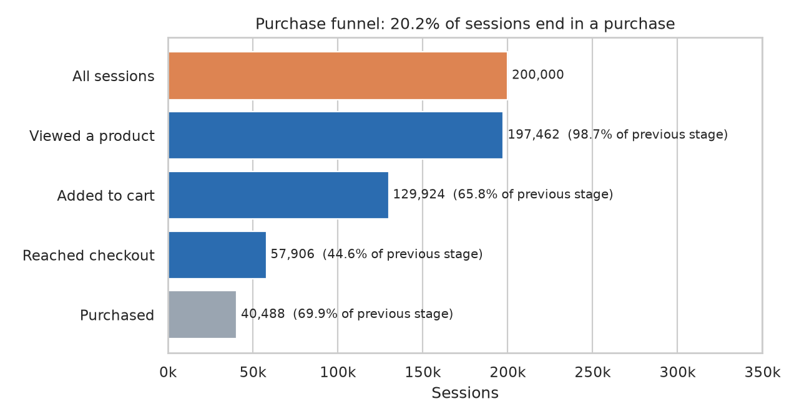
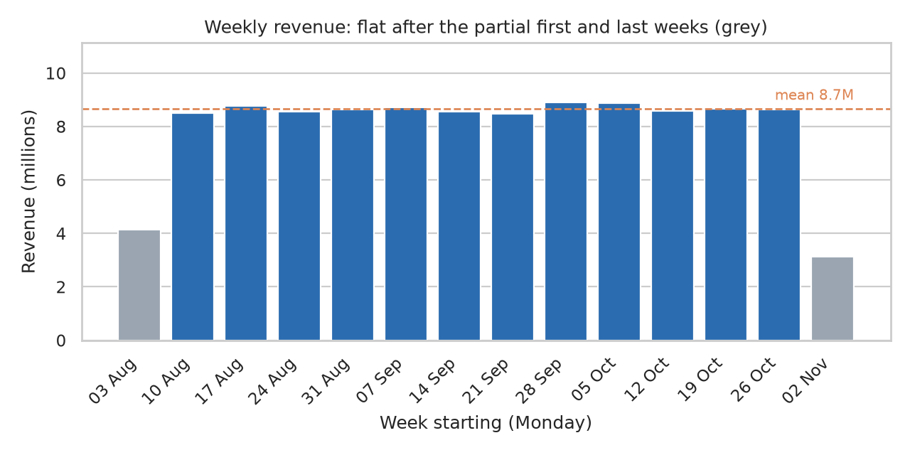
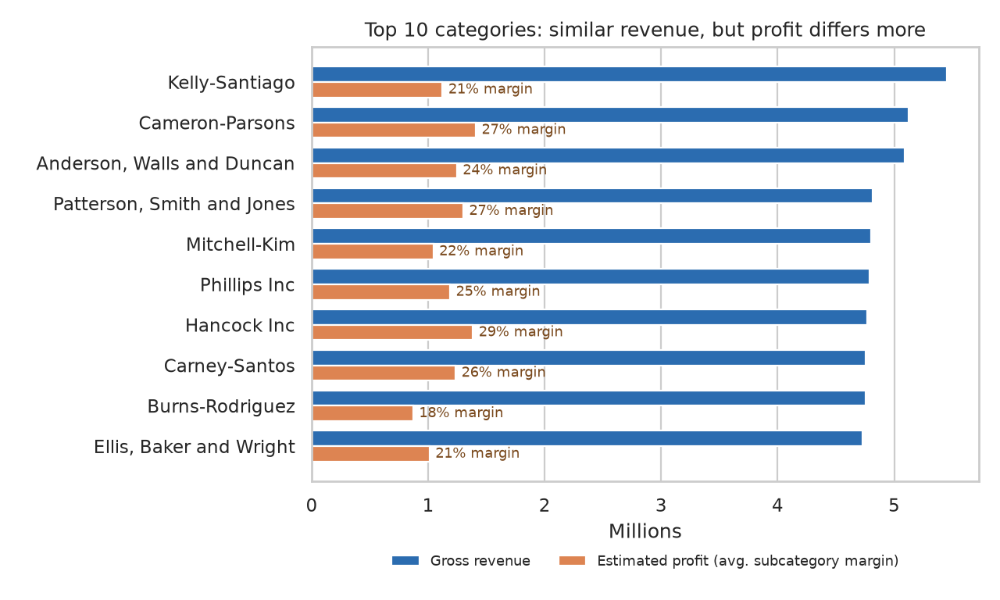
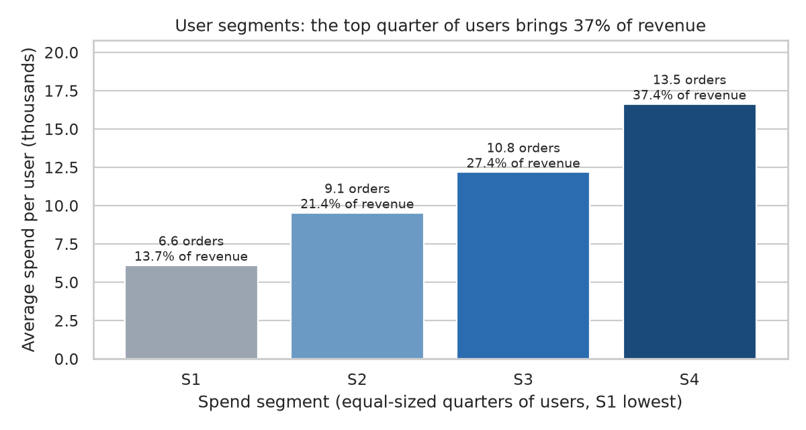
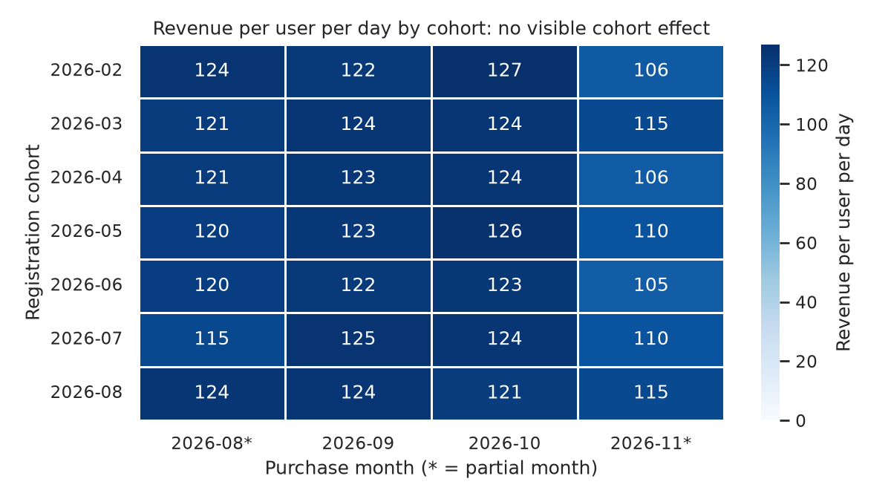

[README.md](https://github.com/user-attachments/files/34681852/README.md)
# Distributed Multi-Model Analytics for E-commerce Data

AUCA Big Data Analytics, final project (October 2026).

This project builds an analytics system for a synthetic e-commerce dataset using three engines, each one doing the job it is best at:

| Engine | What it stores or does | Why |
|---|---|---|
| **MongoDB** (document) | Product catalog, categories, users, transactions | Nested documents (line items, price history, category hierarchy) are read in one go, and aggregation pipelines handle revenue and segmentation |
| **HBase** (wide-column) | User browsing sessions and daily per-product metrics | Row keys designed for time-ordered prefix and range scans, and sparse columns for a variable number of page views |
| **Apache Spark** | Cleaning, cohort analysis, cross-store funnel | Distributed batch processing over 2 million page views, plus Spark SQL to join HBase and MongoDB data |

Everything runs locally in Docker: MongoDB 7.0, HBase 2.1, and a Jupyter + PySpark 4.3 container.

---

## Architecture

```
                      dataset_generator.py
                              │  JSON files (data/)
          ┌───────────────────┼─────────────────────────┐
          ▼                   ▼                         ▼
   load_mongo.py        load_hbase.py            spark_01_ingest.py
          │                   │                         │  Parquet (parquet/*_raw)
          ▼                   ▼                         ▼
   ┌────────────┐      ┌──────────────┐          spark_02_clean.py
   │  MongoDB   │      │    HBase     │                 │  Parquet (parquet/*_clean)
   │ categories │      │ user_sessions│                 ▼
   │ products   │      │ product_daily│          spark_03_cohort.py ──► results/cohort_analysis.csv
   │ users      │      └──────┬───────┘
   │ transactions│            │ sessions (Thrift scan)
   └─────┬──────┘             │
         │ linked txns        │
         └──────────┬─────────┘
                    ▼
            spark_04_funnel.py  (Spark SQL join) ──► results/funnel_*.csv
                    │
   mongo_pipelines.py + results/*.csv
                    ▼
              charts_05.py ──► figures/*.png
```

---

## Repository layout

| Path | Purpose |
|---|---|
| `docker-compose.yml` | MongoDB, HBase and Jupyter/Spark services |
| `jupyter/Dockerfile` | `pyspark-notebook:spark-4.3.0` plus `pymongo`, `happybase`, `thrift`, `seaborn` |
| `dataset_generator.py` | Synthetic data generator (sizes configurable from the command line) |
| `fix_generator.py` | One-time helper that turned the original notebook-format generator into a runnable script. **Already applied, so don't run it again** (see [Notes](#notes-and-known-limitations)) |
| **Part 1: MongoDB** | |
| `load_mongo.py` | Builds the document model, bulk-loads it, and creates indexes |
| `mongo_pipelines.py` | Two aggregation pipelines: revenue by category and user spend segments |
| **Part 1: HBase** | |
| `hbase_common.py` | Connection, row-key builders, table and column-family definitions |
| `load_hbase.py` | Loads `user_sessions` and computes `product_daily` |
| `hbase_queries.py` | Sample queries with timings (prefix scan, range scan, full-scan comparison) |
| **Part 2: Spark** | |
| `spark_common.py` | Spark session config and an explicit session schema |
| `spark_01_ingest.py` | JSON to Parquet, data-quality profile, referential-integrity checks |
| `spark_02_clean.py` | Cleaning and normalisation rules, writes `results/cleaning_report.csv` |
| `spark_03_cohort.py` | Cohort analysis of purchasing by registration month (Spark SQL) |
| **Part 3: Integration** | |
| `spark_04_funnel.py` | Conversion funnel: HBase sessions joined with MongoDB transactions in Spark SQL |
| **Part 4: Visualisation** | |
| `charts_05.py` | Produces the five figures in `figures/` |
| `00_connection_test.ipynb`, `02_hbase.ipynb`, `03_spark.ipynb` | Notebooks used to develop and run the scripts, with saved outputs |
| `results/` | CSV outputs (cleaning report, cohort table, funnels) |
| `figures/` | PNG charts |
| `Screenshots/` | Evidence of the environment, loads, queries and UIs |

---

## Dataset

The data was generated with `dataset_generator.py` and covers **90 days of activity** (6 Aug to 4 Nov 2026):

| Entity | Count | File(s) |
|---|---|---|
| Users | 10,000 | `users.json` |
| Products | 5,000 | `products.json` |
| Categories / subcategories | 25 / 109 | `categories.json` |
| Sessions | 200,000 (1,997,108 page views) | `sessions_0.json`, `sessions_1.json` (~188 MB each) |
| Transactions | 100,000 (40,488 linked to a session) | `transactions.json` |

Total revenue in the data is **$111.1M**.

---

## How to reproduce

### Prerequisites

- Docker Desktop with about 8 GB of memory available. The containers are capped at 1.5 GB (Mongo), 2.5 GB (HBase) and 4 GB (Jupyter).
- Python 3 with `faker` and `numpy` on the host, only needed to generate the data.

### 1. Generate the data

```bash
pip install faker numpy
python dataset_generator.py --users 10000 --products 5000 --sessions 200000 --transactions 100000 --out data
```

### 2. Start the services

```bash
docker compose up -d --build
```

| Service | URL |
|---|---|
| Jupyter | http://localhost:8888 (token `bigdata`) |
| HBase Master UI | http://localhost:16010 |
| Spark UI (while a job runs) | http://localhost:4040 |
| MongoDB | `mongodb://localhost:27017` |

The project folder is mounted at `/home/jovyan/work` inside the Jupyter container. All scripts default to the paths and hostnames inside the container (`mongo`, `hbase`), so **run them inside the container**. `load_hbase.py` also uses the Unix-only `resource` module.

```bash
docker compose exec jupyter bash
cd /home/jovyan/work
```

### 3. Run the pipeline in order

```bash
# Part 1: storage
python load_mongo.py            # categories, products, users, transactions + indexes
python mongo_pipelines.py       # aggregation pipelines 1 and 2
python load_hbase.py            # user_sessions + product_daily (~2.5 min)
python hbase_queries.py         # sample HBase queries with timings

# Part 2: Spark batch
python spark_01_ingest.py       # JSON -> Parquet + quality profile
python spark_02_clean.py        # cleaning -> results/cleaning_report.csv
python spark_03_cohort.py       # -> results/cohort_analysis.csv

# Part 3: integration (needs MongoDB and HBase loaded)
python spark_04_funnel.py       # -> results/funnel_overall|by_device|by_referrer.csv

# Part 4: charts (needs MongoDB and the CSVs above)
python charts_05.py             # -> figures/fig1..fig5.png
```

`00_connection_test.ipynb` checks that Spark, MongoDB and HBase are reachable before you start.

Paths can be overridden with environment variables: `DATA_DIR`, `PARQUET_DIR`, `RESULTS_DIR`, `FIG_DIR`, `MONGO_URI`, `HBASE_HOST`. `load_mongo.py` takes `[data_dir] [mongo_uri]` as positional arguments.

---

## Part 1: Data modelling

### MongoDB (database `ecommerce`)

| Collection | `_id` | Design choices |
|---|---|---|
| `categories` | `category_id` | Subcategories are **embedded** (the hierarchy is small and always read together). A precomputed `avg_profit_margin` is stored for profit estimates. |
| `products` | `product_id` | A **category summary** (id, name, margin) is embedded so catalogue reads need no join. `price_history` is embedded as an array with real `Date` values. |
| `users` | `user_id` | Geo is embedded as a sub-document. `registration_month` is precomputed for cohort grouping. |
| `transactions` | `transaction_id` | Line `items` are **embedded**, and each item also carries a copied `category_id`, so revenue-by-category needs no `$lookup` to products. |

Indexes: `transactions(user_id, timestamp desc)`, `transactions(timestamp)`, `transactions(items.product_id)`, `transactions(items.category_id)`, `products(category.category_id)`, `users(registration_month)`, `users(geo.country)`.

Loaded size: 47 MB of data, which compresses to 8.5 MB on disk plus 8.8 MB of indexes.

**Aggregation pipelines** (`mongo_pipelines.py`):

1. **Revenue by category.** `$unwind` items, then group by category and month, then roll up per category with a monthly trend array, then `$lookup` the category name and margin, then compute estimated profit. Returns the top 10 categories.
2. **User spend segmentation.** Group transactions per user (orders and spend), then `$bucketAuto` into 4 equal-sized spend segments.

### HBase

**`user_sessions`**: one row per session.

- **Row key:** `user_id # reverse_timestamp # session_id`
  - A user's sessions are contiguous, so a prefix scan returns exactly one user.
  - The reverse timestamp (`9999999999999 − epoch_ms`) makes the newest session sort first.
  - The `session_id` suffix keeps keys unique.
- **Column families:**
  - `meta`: session id, user, times, duration, status, referrer, device, OS, browser, geo, IP.
  - `pv`: one sparse column per page view, `pv:00`, `pv:01`, … with value `timestamp|page_type|product_id|category_id|duration`.
  - `cart`: one sparse column per product in the cart, `cart:<product_id>` with value `quantity|price`.

Splitting the families lets list queries read only the small `meta` family.

**`product_daily`**: product performance over time.

- **Row key:** `product_id # yyyymmdd`, so one product's history is a single contiguous range scan.
- **Family `stats`:** `views`, `cart_adds`, `units_sold`, `units_sold_linked`, `revenue`.

All families use `max_versions=1`, a ROW bloom filter and the block cache.

**Load results:** 200,000 session rows (5.0M cells) and 369,425 `product_daily` rows in about 2.5 minutes.

**Query timings** (`hbase_queries.py`, user `user_000042`):

| Query | Time |
|---|---|
| Q1 All sessions of one user (prefix scan, `meta` only) | 210 ms |
| Q2 Latest session with all page views and cart | 11 ms |
| Q3 One user's sessions in a 30-day window (row range) | 9 ms |
| Q4 One product's daily stats for September (range scan) | 16 ms |
| Q5 Same as Q1 but via a full-table `RowFilter` | **2,595 ms** |

Q5 returns the same answer as Q1 but scans the whole table, which shows how much the row-key design matters.

**Why sessions live in HBase and not MongoDB:** sessions are the high-volume, append-only, time-ordered data. They are always read as "this user's recent activity" or "this product over a date range", which is exactly what HBase key-range scans are good at. Catalogue, users and transactions are smaller, richly nested, and queried with ad-hoc aggregations, which suits MongoDB better.

---

## Part 2: Spark processing

- **Ingest** (`spark_01_ingest.py`): reads the multi-line JSON with an **explicit schema**, which avoids an extra inference pass over 376 MB. It converts everything to Parquet (~62 s for sessions) and profiles quality and referential integrity. Converted sessions without a transaction: 0. Linked transactions without a session: 0.
- **Clean** (`spark_02_clean.py`): deduplicates on ids, trims and case-normalises text, derives date, hour and weekday, and computes page-flow flags with higher-order functions (`exists`, `filter`, `aggregate`). It also validates transaction arithmetic. Generator inconsistencies are **flagged, not deleted**:

  | Check | Rows | % |
  |---|---|---|
  | Sessions with zero-duration page views | 9,814 | 4.9 |
  | Cart/checkout/confirmation page with an empty cart | 43,754 | 21.9 |
  | Confirmation page without a purchase | 34,440 | 17.2 |
  | Transactions not linked to a session | 59,512 | 59.5 (kept, excluded from funnel) |
  | Inactive products / zero stock | 234 / 376 | 4.7 / 7.5 |

  Duplicates, null keys and arithmetic mismatches: none found.
- **Cohort analysis** (`spark_03_cohort.py`): a Spark SQL query with CTEs and a window function. It groups users by registration month and computes buyers %, orders, revenue per user, revenue per user **per observed day** (August and November are partial months), and cumulative revenue per user.

Spark runs as `local[2]` with 2 GB driver memory and 8 shuffle partitions, which is sized for a laptop.

---

## Part 3: Integrated query (conversion funnel)

**Business question:** where do shoppers drop out between viewing a product and paying, and does it differ by device or traffic source?

**Workflow** (`spark_04_funnel.py`):

1. **HBase:** scan `user_sessions`, reading only the `meta` columns needed plus `pv` and `cart`. Page views are reduced to yes/no flags while streaming, so memory stays small.
2. **MongoDB:** fetch only transactions with `session_id != null`, using a projection.
3. **Spark SQL:** left-join sessions to transactions on `session_id`, then compute the stage counts and conversion rates overall, by device and by referrer.

An integrity check confirms that the 40,488 purchases in MongoDB match the 40,488 sessions marked `converted` in HBase exactly, with 0 mismatches and 0 orphans.

---

## Part 4: Results and insights

| Figure | Finding |
|---|---|
|  | **20.2% of sessions end in a purchase.** The biggest leak is **cart to checkout (44.6%)**. View to cart is 65.8% and checkout to purchase is 69.9%. |
|  | Revenue is **flat at about $8.7M per week**. The first and last weeks are only partial. There is no seasonality in the data. |
|  | The top 10 categories earn similar revenue ($4.7M–$5.5M), but **estimated margin ranges from 18% to 29%**. The largest category by revenue is not the most profitable. |
|  | The **top quarter of users brings 37.4% of revenue** (13.5 orders each), and the bottom quarter brings 13.7%. |
|  | **No cohort effect.** From August to October, every registration cohort spends about $115–127 per user per day, and 93–98% of each cohort buys every month. |

The funnel is nearly identical across devices (20.2–20.3%) and referrers (19.9–20.6%). These flat results come from the generator, which picks device, referrer and timing uniformly at random. They are a property of the synthetic data rather than real customer behaviour, and the report should say so.

---

## Notes and known limitations

- **Re-generating changes the data.** The generator uses dates relative to "now" and unseeded `uuid` ids. If you regenerate, update the hard-coded dates in `hbase_queries.py` (Q3 and Q4), and expect the numbers above to shift.
- **Don't re-run `fix_generator.py`.** It first copies `dataset_generator.py` over `dataset_generator_notebook_backup.json`, then fails because the script is no longer a notebook. That overwrites the original backup.
- **Single-node setup.** Spark runs in local mode and HBase runs as a single standalone container. Reading HBase through Thrift/happybase into the Spark driver works at 200k sessions. At larger scale you would use the HBase–Spark connector or snapshot export, plus the MongoDB Spark connector.
- **Synthetic data.** The data is uniformly random, so segment comparisons are flat. Profit is estimated from the *average* subcategory margin, because products carry only a `category_id`.
- `data/` is git-ignored because the session files are about 376 MB. Regenerate the data with step 1.
